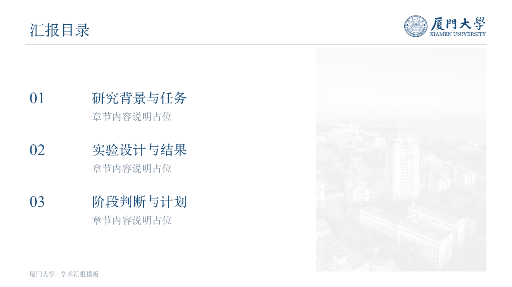
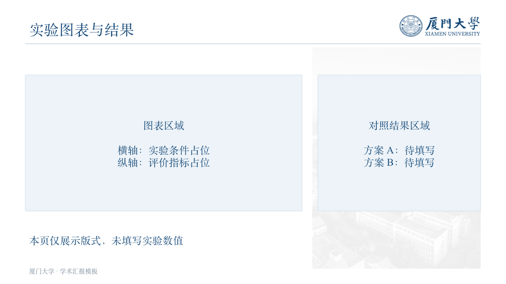
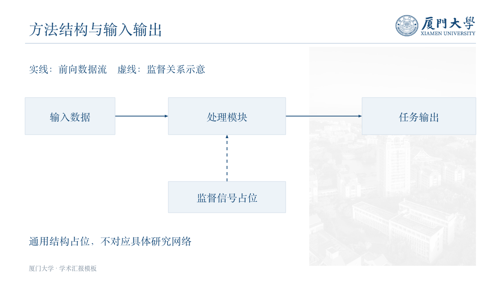
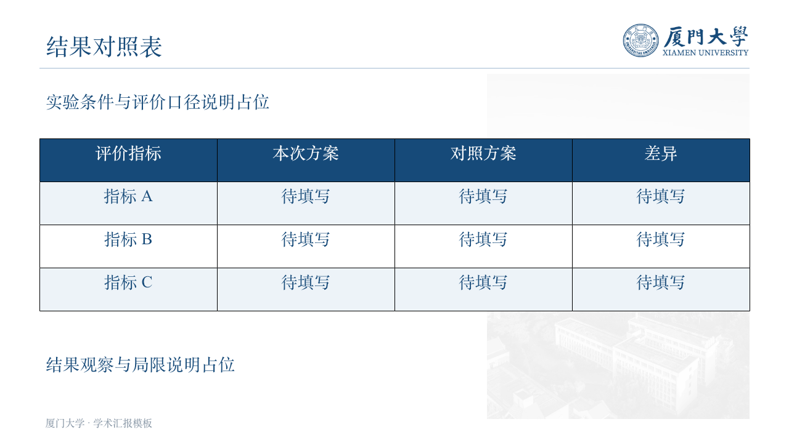
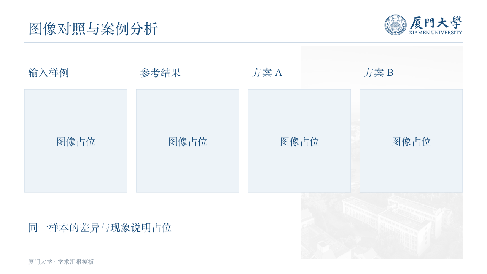

# xmu-academic-ppt

用于制作厦门大学风格的可编辑学术汇报 PPT 的 Codex 技能，优先面向组会工作汇报。

从研究笔记、实验协议、原始指标与预测案例整理内容，按部分确认并制作页面。重点是把研究工作讲清楚，保持实验结果可追溯，让汇报人能够准确解释每一页。

## 页面效果

以下页面均使用通用文字占位制作，并在导出 PPTX 后重新读取、渲染，仅展示排版形式。预览不包含真实课题、数据集、模型、实验数值、样本或个人信息。

### 封面

蓝色校园插画背景，搭配完整白色校徽及中英文校名。标题、主题与日期保持可编辑。


### 目录

按实际内容组织章节，增删页面后同步更新章节范围及页码。



### 实验结果

展示图表与对照表格的版式区域，图表、指标和数值均为待填写占位。



### 方法结构图

使用输入、处理模块、输出及监督等通用节点展示可编辑方法图的排版，不对应任何实际研究网络。



<details>
<summary>查看更多：基线对照、预测案例与结束页</summary>

#### 基线复现对照



#### 图像对照版式



#### 结束页


</details>

## 主要特点

- **内容先行**：先整理完整材料清单，再按部分确认正文、数值、图表与判断，随后提供真实页面预览。
- **不固定页数**：详略由研究内容决定，必要时拆页，不为压缩篇幅遗漏证据。
- **结果统一口径**：核对数据划分、预算、随机种子、训练阶段和选模规则，同步审核表格、曲线与结论。
- **研究状态准确**：区分候选设计、接口检查、完整训练与性能评价，保留负结果和待验证事项。
- **表达可解释**：方法先讲原理和过程，再说明本项目如何采用或修改；术语、预算和比较边界主动解释。
- **保持可编辑**：研究文字、表格、数据图表与方法结构使用原生对象，不将整页转成图片。

## 使用方式

### 在 Codex 中安装

下载此仓库的 ZIP 并解压，将包含 `SKILL.md` 的目录命名为 `xmu-academic-ppt`，放入 Codex 技能目录。默认位置为：

```text
~/.codex/skills/xmu-academic-ppt/
```

如已设置 `CODEX_HOME`，则放入该目录下的 `skills/xmu-academic-ppt/`。如果已经安装本技能，先保留旧版和自己的改动，再更新文件。

### 发起任务

可以在 Codex 中明确调用：

```text
使用 $xmu-academic-ppt，帮我准备本次组会汇报。
先整理材料范围与完整内容清单，再逐部分确认内容、制作并展示预览。
```

也可以提供具体材料与重点：

```text
根据我指定日期范围的 Notion 笔记和实验结果，制作组会 PPT。
重点展示实验设置、完整结果、预测案例、阶段判断和下一步。
页数根据内容调整，研究方案与已完成结果分别标明。
```

## 工作流程

1. **确定范围**：从已授权材料中识别主题、时间范围与实际进展，列出来源及缺口。
2. **整理内容**：按研究问题或任务组织完整内容清单，解释设置与结果口径。
3. **分部分确认**：提供各页完整内容、指标、图表安排与拟表达判断；明确要求直接制作时可连续推进。
4. **制作与审阅**：使用基础模板，按实际材料调整布局，展示真实页面预览。
5. **最终交付**：核对日期、目录、页码、数值、字体与可编辑性，重新读取并渲染最终 PPTX。

## 视觉规范

- 16:9，蓝白学术风格，主色为 `#164A79`。
- 中文使用宋体系列，英文和数字使用 Times New Roman，检查实际可用字体。
- 封面与结束页使用校园全景插画及完整白色校标。
- 白底正文右上角使用完整蓝色校标；背景装饰按证据图表密度调整。
- 模板中的示例分栏与占位框可以删除或重排，内容不必迁就示例布局。

完整要求见 [视觉规范](references/visual-design.md)。校园封面是插画，不作为纪实照片或研究证据。

## 运行条件与材料来源

- 在可使用 presentations 技能及其配套工具的 Codex 环境中制作、编辑和导出 PPT。此仓库不是独立运行的幻灯片生成程序。
- 读取 Notion 时，需要环境中有可用的 Notion 连接及相应访问权限。
- 读取远程实验时，需要用户授权及用户自行配置的连接信息。本仓库不提供个人服务器别名、目录、账号或凭据。
- 模板、校标和校园素材已保存在 `assets/`。完整协作规则见 [SKILL.md](SKILL.md)，材料读取规则见 [材料与证据](references/sources.md)。

仅修改技能或讨论规则，不会自动扫描 Notion、连接实验服务器或启动训练。整理汇报也不会自行启动、停止或重新训练实验。

## 仓库结构

```text
xmu-academic-ppt/
├── README.md
├── SKILL.md
├── references/
│   ├── visual-design.md
│   └── sources.md
├── assets/
│   ├── base-template.pptx
│   ├── xmu-logo-original.png
│   ├── campus-cover.png
│   └── campus-photo.png
└── docs/
    └── previews/                 # README 使用的实际页面渲染图
```

如果 GitHub 仓库本身名为 `xmu-academic-ppt`，上述文件和目录应直接位于仓库根目录，不必再套一层同名文件夹。

## 备份与更新

个人备份可使用私有仓库。网页上传时，将本目录的 `README.md`、`SKILL.md`、`assets/`、`references/` 和 `docs/` 一起上传，图片才能在 README 中正常显示。

本地更新后需要再次上传或通过 Git 提交推送，GitHub 不会自动同步本地技能目录。仓库仅包含通用技能、模板与占位预览，不包含个人笔记导出、真实研究页面、实验日志、模型权重或完整研究汇报。

本仓库为个人学术汇报工具整理，不代表厦门大学官方发布。校名、校徽及相关素材的使用应尊重原有权利；本仓库不为第三方标识或素材另行授予许可。
